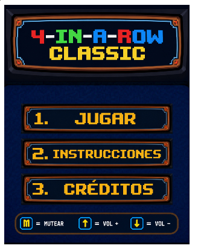
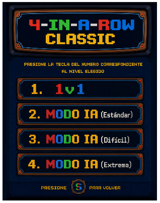
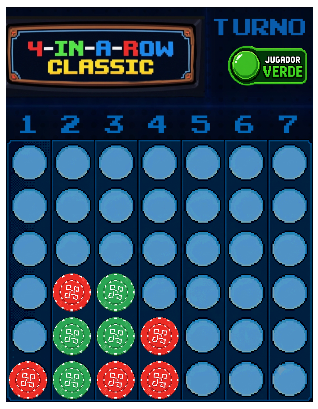
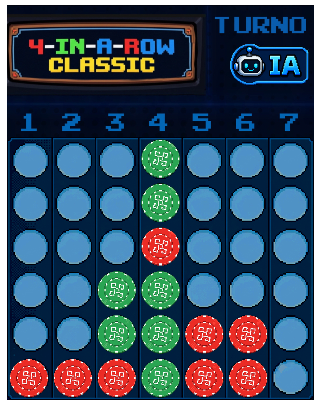
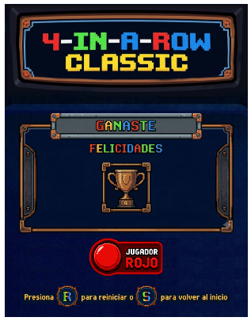

# Cuatro-en-Linea

## Equipo de desarrollo

- Borinsky Tomas
- Lopez Axel
- Racedo Kevin
- Katia Soler
- Narancio D. Lucas

## Capturas del juego en funcionamiento
#### Imagen de la pantalla de inicio del juego
 

#### Imagen de los modos del juego

#### Imagen del modo de juego 1v1

#### Imagen del modo de juego contra la IA

#### Imagen de un ejemplo de fin de juego

## Reglas de Juego / Instrucciones
# 🎮 Cómo jugar

**4-in-a-Row** es una versión del clásico **Cuatro en Línea**. El objetivo del juego es ser el primero en conectar cuatro fichas consecutivas de tu color antes que tu oponente.

## 🎯 Objetivo

Conectá **4 fichas de tu color** en una línea:

- Horizontal
- Vertical
- Diagonal

## 🎮 Modos de juego

El juego cuenta con cuatro modos:

- **1 vs 1:** Dos jugadores comparten el mismo teclado.
- **VS IA (Estándar):** La IA realiza movimientos básicos y es ideal para principiantes.
- **VS IA (Difícil):** La IA utiliza una estrategia más inteligente y representa un mayor desafío.
- **VS IA (Extrema):** La IA juega con su mejor estrategia, buscando aprovechar cada oportunidad para ganar y bloquear tus jugadas.
## ⌨️ Controles

| Tecla | Acción |
|:-----:|--------|
| **1** | Iniciar modo **1 vs 1** |
| **2** | Iniciar modo **VS IA (Estándar)** |
| **3** | Iniciar modo **VS IA (Difícil)** |
| **4** | Iniciar modo **VS IA (Extrema)** |
| **1 - 7** | Elegir la columna donde caerá la ficha |
| **R** | Reiniciar la partida |
| **S** | Volver al menú principal |
| **M** | Mute |
| **↓** | Bajar volumen |
| **↑** | Subir volumen |

## 📖 Mecánica del juego

1. Elegí el modo de juego seleccionando la tecla del número correspondiente al nivel que se quiera jugar.
2. En cada turno, seleccioná una columna presionando una tecla del **1 al 7**.
3. La ficha caerá automáticamente hasta la posición libre más baja de la columna.
4. Los jugadores alternan turnos hasta que uno consiga conectar cuatro fichas o el tablero se llene.
5. Si el tablero se llena y nadie conecta cuatro fichas, la partida termina en **empate**.

## 🏆 Condición de victoria

Ganará el jugador que consiga conectar **cuatro fichas consecutivas** de su color en cualquier dirección:

- ➖ Horizontal
- ➖ Vertical
- ➖ Diagonal

## Otros

- Materia: Programación con objetos 1 / Universidad Nacional de Hurlingham
- Versión de wollok : 4.2.3
- Una vez terminado, no tenemos problemas en que el repositorio sea público 